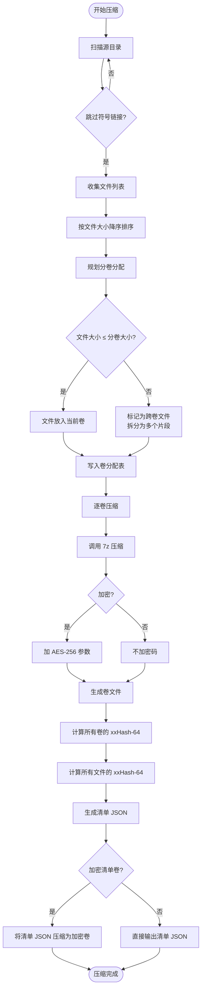
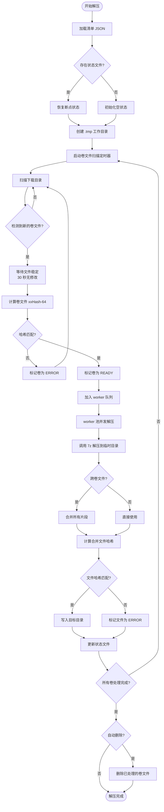
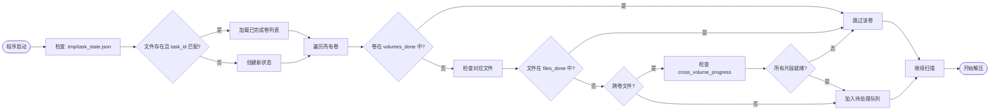

# PeakZip — 低峰值分卷压缩 / 解压管理工具
> **注：本项目由 AI 实现（AI-generated），CI 已禁用。**


一个面向大型项目归档的图形化工具。通过逻辑分卷、哈希校验、7-Zip 集成和断点续传，
让用户以**低磁盘峰值**的方式压缩、传输和恢复任意规模的目录树。

---

## 目录

- [核心特性](#核心特性)
- [快速开始](#快速开始)
- [使用指南](#使用指南)
  - [压缩](#压缩)
  - [解压](#解压)
  - [分卷格式](#分卷格式)
  - [断点续传](#断点续传)
- [命令行参数](#命令行参数)
- [架构设计](#架构设计)
- [清单文件结构](#清单文件结构)
- [状态文件结构](#状态文件结构)
- [日志系统](#日志系统)
- [7-Zip 内嵌](#7-zip-内嵌)
- [跨平台编译](#跨平台编译)
- [依赖](#依赖)
- [开发](#开发)
- [许可证](#许可证)

---

## 核心特性

| 特性 | 说明 |
|------|------|
| **图形化界面** | 基于 [Fyne v2](https://fyne.io/) 的原生 GUI，全中文界面 |
| **逻辑分卷** | 按指定大小将目录树切分为多个独立卷文件，单卷可独立传输 |
| **哈希校验** | 每个文件和每个卷计算 xxHash-64 校验值，解压时自动验证完整性 |
| **加密** | 支持 AES-256 加密，可对数据卷和清单卷加密（使用 7-Zip 内置算法） |
| **跨卷文件** | 单个文件可跨多个卷，自动拆分和合并 |
| **断点续传** | 解压进度持久化，中断后自动恢复，跳过已完成的卷和文件 |
| **自动删除** | 可选解压完成后自动删除已处理的卷文件 |
| **7-Zip 内嵌** | 无需用户安装 7-Zip，程序自带双平台 7z 可执行文件 |
| **调试模式** | `-debug` 参数开启详细日志，输出到程序当前目录 |

---

## 快速开始

### Windows

1. 下载 `peakzip.exe` 并放入任意目录
2. 双击运行
3. 无需安装 7-Zip（已内嵌）

### Linux

```bash
# 编译
go build -o peakzip .

# 运行（需要系统安装 7z 或依赖内嵌版本）
./peakzip
```

### 命令行参数

```bash
peakzip              # 正常模式
peakzip -debug       # 调试模式（生成 peakzip_debug.log）
peakzip -h           # 显示帮助
```

---

## 使用指南

### 压缩

1. 点击工具栏 **「压缩」** 按钮
2. 填写配置：
   - **项目名称**：输出文件的命名前缀（如 `myproject`）
   - **源目录**：要压缩的目录
   - **输出目录**：卷文件的保存位置
   - **分卷大小 (MB)**：每个卷的最大大小（推荐 100–500 MB）
   - **密码**：留空则不加密
   - **加密清单卷**：勾选后清单卷也加密
3. 点击 **「开始压缩」**

压缩完成后，输出目录中生成：

```
myproject.000-N.7z        ← 数据卷 0
myproject.001-N.7z        ← 数据卷 1
...
myproject-manifest.json   ← 清单文件
myproject.NNN-N.7z        ← 清单卷（加密时可选）
```

`N` 是数据卷总数，`NNN` 是带前导零的数据卷总数（清单卷的索引位与数据卷 0 错开，避免命名冲突）。

### 解压

1. 点击工具栏 **「解压」** 按钮
2. 填写配置：
   - **清单文件**：选择 `myproject-manifest.json` 或 `myproject.NNN-N.7z`（清单卷）
   - **下载目录**：卷文件所在目录
   - **解压目录**：文件输出位置
   - **密码**：如有加密则填写
   - **解压完成后删除卷文件**：可选
3. 点击 **「开始解压」**

程序会自动：
- 扫描下载目录，检测哪些卷文件可用
- 校验文件哈希（稳定窗口默认 30 秒）
- 并发解压已就绪的卷（默认 4 个 worker）
- 保存进度状态，支持中断后恢复

### 分卷格式

**卷文件命名规则**：`{项目名}-{序号}.7z`

```
myproject.000-N.7z    ← 数据卷 0
myproject.001-N.7z
...
myproject-manifest.json    ← 清单（可选加密为 .7z）
```

**跨卷文件**：单个文件若超过分卷大小，自动拆分为多个片段，分别存储在连续卷中。
解压时自动合并并校验合并后文件的哈希。

**加密**：使用 7-Zip 内置的 AES-256 加密；密钥派生由 7-Zip 负责，不引入第三方 KDF。

### 断点续传

解压过程中，进度实时保存到 `.tmp/task_state.json`：

```json
{
  "task_id": "myproject",
  "volumes_done": ["/path/out/myproject.000-3.7z", "/path/out/myproject.001-3.7z"],
  "volumes_ready": ["/path/out/myproject.002-3.7z"],
  "files_done": ["documents/readme.txt"],
  "cross_volume_progress": {
    "videos/large.mp4": {
      "needed": ["vol_1", "vol_2"],
      "done": ["vol_1"]
    }
  }
}
```

再次运行解压时，程序自动加载状态文件，跳过已完成的卷和文件。

---

## 命令行参数

| 参数 | 默认值 | 说明 |
|------|--------|------|
| `-debug` | `false` | 启用调试模式：在程序当前目录生成 `peakzip_debug.log`，日志级别为 DEBUG |
| `-h` | — | 显示帮助信息 |

---

## 架构设计

```
┌─────────────────────────────────────────────────────────────┐
│                        UI Layer                              │
│  ui/app.go        主窗口、工具栏、视图切换                      │
│  ui/compress_view.go   压缩界面                              │
│  ui/decompress_view.go 解压界面                              │
│  ui/log_window.go      日志查看器（可重建的二级窗口）           │
│  ui/manifest_view.go   清单查看器（可重建的二级窗口）           │
│  ui/settings_panel.go  设置面板（可重建的二级窗口）             │
├─────────────────────────────────────────────────────────────┤
│                      Task Layer                              │
│  task/compress.go      压缩任务调度                          │
│  task/decompress.go    解压任务调度（worker 池）               │
│  task/types.go         任务配置、进度更新、卷状态               │
├─────────────────────────────────────────────────────────────┤
│                    Domain Layer                              │
│  scanner/          目录扫描与排序                             │
│  manifest/         清单生成与解析                             │
│  hasher/           xxHash-64 校验                            │
│  state/            断点续传状态管理                           │
├─────────────────────────────────────────────────────────────┤
│                   Infrastructure Layer                       │
│  archiver/         7-Zip 命令封装                             │
│  sevenzip/         内嵌 7z 二进制（embed）                     │
│  logger/           分级日志（多文件 + UI 订阅）                 │
└─────────────────────────────────────────────────────────────┘
```

### 包职责

| 包 | 职责 |
|----|------|
| `scanner` | 递归扫描目录树，跳过符号链接，按文件大小降序排序 |
| `manifest` | 生成 / 解析 JSON 清单，支持加密配置和跨卷文件描述 |
| `hasher` | 计算文件和字节的 xxHash-64 校验值 |
| `archiver` | 封装 7z 命令：压缩、分卷压缩、解压、校验、加密参数 |
| `sevenzip` | 通过 `embed` 嵌入 Linux / Windows 平台的 7z 二进制，运行时提取到临时目录 |
| `state` | 管理断点续传状态：卷状态、文件状态、跨卷进度、删除队列 |
| `task` | 压缩 / 解压任务调度，worker 池并发控制，进度回调 |
| `logger` | 分级日志（DEBUG/INFO/WARNING/ERROR），多文件输出 + UI channel 订阅 |
| `ui` | Fyne v2 GUI，主窗口 + 四个可重建的二级窗口 |

### 压缩流程



### 解压流程



### 断点续传流程



---

## 清单文件结构

清单 JSON（`{项目名}-manifest.json`）：

```json
{
  "manifest_version": 1,
  "project_name": "myproject",
  "total_volumes": 10,
  "volume_size_limit": 104857600,
  "compression_algorithm": "LZMA2",
  "encryption": {
    "enabled": true,
    "method": "AES-256"
  },
  "files": [
    {
      "path": "documents/readme.txt",
      "size": 12345,
      "hash": "a1b2c3d4e5f60718",
      "volume": 3,
      "is_cross_volume": false
    },
    {
      "path": "videos/large.mp4",
      "size": 1073741824,
      "hash": "1122334455667788",
      "volume": 5,
      "is_cross_volume": true,
      "volume_start": 5,
      "volume_end": 7,
      "fragments": [
        { "volume": 5, "offset": 0, "length": 104857600 },
        { "volume": 6, "offset": 0, "length": 104857600 },
        { "volume": 7, "offset": 0, "length": 104857600 }
      ]
    }
  ],
  "volumes": [
    {
      "logical_number": 0,
      "filename": "myproject.000-3.7z",
      "size": 104857600,
      "hash": "deadbeefcafebabe",
      "type": "data",
      "contains": ["docs/intro.pdf", "docs/guide.pdf"]
    },
    {
      "logical_number": 1,
      "filename": "myproject.001-3.7z.001",
      "size": 104857600,
      "hash": "0123456789abcdef",
      "type": "data",
      "contains": ["videos/large.mp4"]
    },
    {
      "logical_number": 3,
      "filename": "myproject.003-3.7z",
      "size": 4521,
      "type": "manifest"
    }
  ]
}
```

### 字段说明

| 字段 | 类型 | 说明 |
|------|------|------|
| `manifest_version` | int | 清单格式版本，当前为 1 |
| `project_name` | string | 项目名称 |
| `total_volumes` | int | 总卷数（含清单卷） |
| `volume_size_limit` | int64 | 分卷大小上限（字节） |
| `compression_algorithm` | string | 压缩算法 |
| `encryption.enabled` | bool | 是否加密 |
| `encryption.method` | string | 加密方法（AES-256） |

| `files[].path` | string | 文件相对路径 |
| `files[].size` | int64 | 文件大小（字节） |
| `files[].hash` | string | 文件 xxHash-64 十六进制值 |
| `files[].volume` | int64 | 所在卷的逻辑编号 |
| `files[].is_cross_volume` | bool | 是否为跨卷文件 |
| `files[].fragments` | array | 跨卷文件的片段信息 |
| `volumes[].logical_number` | int64 | 卷逻辑编号 |
| `volumes[].filename` | string | 卷文件名 |
| `volumes[].type` | string | `"data"` 或 `"manifest"` |
| `volumes[].contains` | array | 该卷包含的文件路径列表 |

---

## 状态文件结构

解压进度文件（`.tmp/task_state.json`）：

```json
{
  "task_id": "myproject",
  "volumes_ready": ["/path/out/myproject.003-3.7z"],
  "volumes_done": ["/path/out/myproject.000-3.7z", "/path/out/myproject.001-3.7z", "/path/out/myproject.002-3.7z"],
  "files_done": ["documents/readme.txt"],
  "cross_volume_progress": {
    "videos/large.mp4": {
      "needed": ["vol_5", "vol_6", "vol_7"],
      "done": ["vol_5"]
    }
  },
  "delete_queue": ["/path/out/myproject.000-3.7z"]
}
```

---

## 日志系统

### 日志文件

| 文件 | 位置 | 说明 |
|------|------|------|
| `peakzip.log` | `~/.peakzip/` | 常规日志（INFO 级），始终写入 |
| `peakzip_debug.log` | 程序当前目录 | 调试日志（DEBUG 级），仅 `-debug` 模式下创建 |

### 日志格式

```
[2026-08-30T12:00:01+08:00] [DEBUG] 应用程序初始化完成
[2026-08-30T12:00:05+08:00] [INFO] 扫描源目录：/home/user/project
[2026-08-30T12:00:05+08:00] [INFO] 共发现 142 个文件
```

### 日志级别

| 级别 | 说明 |
|------|------|
| `DEBUG` | 调试信息：窗口生命周期、任务配置、详细进度 |
| `INFO` | 常规信息：任务开始/完成、文件操作 |
| `WARNING` | 警告：可恢复的问题 |
| `ERROR` | 错误：需要关注的异常 |

### 查看日志

GUI 中点击工具栏 **「日志」** 按钮打开日志查看器，支持按级别筛选。

---

## 7-Zip 内嵌

程序通过 Go 的 `embed` 功能在编译时嵌入 7z 可执行文件：

| 平台 | 嵌入文件 | 大小 |
|------|---------|------|
| Linux | `sevenzip/embedded/7z_linux` | ~679 KB |
| Windows | `sevenzip/embedded/7z.exe` | ~563 KB |

运行时查找顺序：

1. 用户在设置面板中手动指定的路径
2. 系统 PATH 或常见安装路径（`exec.LookPath`）
3. 内嵌版本（运行时提取到临时目录）

7z 提取目录在程序退出时通过 `archiver.Close()` 自动清理。

---

## 跨平台编译

### Windows (amd64)

```bash
# 需要 MinGW 交叉编译器
apt install gcc-mingw-w64-x86-64

GOOS=windows GOARCH=amd64 CGO_ENABLED=1 \
CC=x86_64-w64-mingw32-gcc CXX=x86_64-w64-mingw32-g++ \
go build -ldflags "-H windowsgui" -o peakzip.exe .
```

> `-H windowsgui` 隐藏运行时控制台窗口。

### Linux (amd64)

```bash
go build -o peakzip .
```

### 依赖

| 平台 | 系统依赖 |
|------|---------|
| Linux | `libgl1-mesa-dev`, `libx11-dev`, `libxcursor-dev`, `libxrandr-dev`, `libxinerama-dev`, `libxi-dev`, `libwayland-dev`, `libglu1-mesa-dev`, `libxkbcommon-dev`, `libxxf86vm-dev`, `pkg-config`, `gcc` |
| Windows | MinGW-w64（交叉编译时） |

---

## 依赖

### 核心依赖

| 包 | 版本 | 用途 |
|----|------|------|
| `fyne.io/fyne/v2` | v2.8.1 | GUI 框架 |
| `github.com/cespare/xxhash/v2` | v2.1.1 | xxHash-64 校验 |

### 系统依赖

| 工具 | 用途 |
|------|------|
| `7z` (7-Zip) | 压缩 / 解压引擎（已内嵌） |

---

## 开发

### 项目结构

```
peakzip/
├── main.go                     入口文件
├── go.mod / go.sum             模块定义
├── archiver/                   7-Zip 命令封装
├── hasher/                     xxHash-64 校验
├── logger/                     分级日志
├── scanner/                    目录扫描
├── manifest/                   清单生成 / 解析
├── state/                      断点续传状态
├── task/                       任务调度
│   ├── types.go
│   ├── compress.go
│   └── decompress.go
├── sevenzip/                   内嵌 7z 二进制
│   ├── embedded/
│   │   ├── 7z_linux
│   │   └── 7z.exe
│   ├── sevenzip.go
│   ├── sevenzip_linux.go
│   ├── sevenzip_windows.go
│   └── sevenzip_other.go
└── ui/                         图形界面
    ├── app.go
    ├── compress_view.go
    ├── decompress_view.go
    ├── log_window.go
    ├── manifest_view.go
    └── settings_panel.go
```

### 开发命令

```bash
# 格式化
go fmt ./...

# 静态检查
go vet ./...

# 编译（Linux）
go build -o peakzip .

# 编译（Windows）
GOOS=windows GOARCH=amd64 CGO_ENABLED=1 \
CC=x86_64-w64-mingw32-gcc \
go build -ldflags "-H windowsgui" -o peakzip.exe .

# 调试模式运行
./peakzip -debug
```

---

## 许可证

本项目为专有软件。版权所有。
